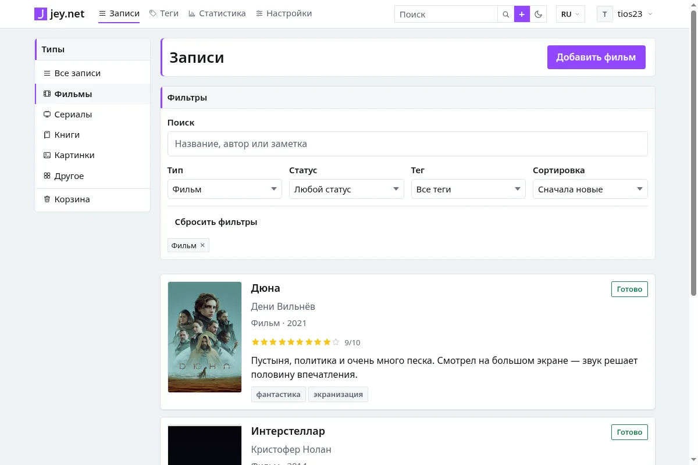

# jey.net

Личный портал для коллекционирования того, что ты смотрел, читал и сохранял:
фильмы, сериалы, аниме, книги, игры и «всякое такое» — в одном месте, со своими
оценками, заметками, коллекциями, социальной лентой и личным чатом.

Работает по модели **local-first**: desktop хранит каталог и encrypted-кеш
чата локально и работает без интернета; сервер синхронизирует устройства и
обслуживает веб-версию.

**Живой сайт:** https://j3ynet.site



## Что уже работает

- **Аккаунты:** регистрация, вход, выход, смена и сброс пароля,
  подтверждение email, удаление аккаунта, аватар, отзыв всех сессий.
- **Записи:** фильмы, сериалы, аниме, книги, игры, картинки, «другое»;
  статусы, оценки 1–10, заметки, ссылки-источники, коллекции, мягкое удаление
  и восстановление.
- **Поиск и фильтры:** триграммный поиск по названию, автору и заметке,
  фильтры по типу, статусу, году и оценке, сортировки и курсорная пагинация.
- **Социальное:** подписки, лента, публичные профили, комментарии, ответы,
  лайки, реакции, рекомендации, уведомления и жалобы.
- **Чат:** direct 1:1, инбокс, unread/read/mute, SSE realtime, реакции,
  редактирование, поиск, typing и E2E-шифрование новых сообщений.
- **Статистика:** всего записей, разбивка по типам и статусам, средняя
  оценка, по годам и за последние 12 месяцев.
- **Медиа:** загрузка JPEG/PNG/WebP до 10 МБ, обложки и аватары,
  WebP-рендиции 1200 и 400 px, квота 200 МБ на аккаунт, сборка мусора.
- **Экспорт и импорт:** JSON и CSV, идемпотентный импорт.
- **Публичный профиль:** по желанию, только завершённые записи; публичные
  коллекции и комментарии.
- **Прод:** HTTPS (Let's Encrypt), systemd, мониторинг, деплой одной командой
  с миграциями и откатом.

## Стек

| Слой | Технология |
|---|---|
| Ядро | Rust (edition 2024), крейт `jey-core` — домен и правила синхронизации |
| Сервер | axum, tokio, sqlx, PostgreSQL 18 |
| Веб | Vite, React 19, React Router, TypeScript, CSS Modules |
| Десктоп | Tauri 2 + SQLite, shared SPA, offline outbox |
| Пароли и сессии | argon2id, непрозрачные токены, в базе только SHA-256 |
| Realtime | SSE + PostgreSQL LISTEN/NOTIFY |
| Деплой | VPS + Caddy + systemd, деплой-скрипт с откатом |
| CI | GitHub Actions |

Подробнее — [docs/stack.md](docs/stack.md).

## Быстрый старт

Нужны Rust, Node.js 22 и PostgreSQL 18.

```bash
cp .env.example .env                 # адрес БД и настройки
bash scripts/db.sh create            # создать базу (если ещё нет)
bash scripts/db.sh migrate           # применить миграции

cargo run -p jey-api                 # API на http://127.0.0.1:8080

cd apps/web
npm ci
npm run dev                          # SPA на http://localhost:5174
```

Демо-данные:

```bash
bash scripts/seed.sh                 # аккаунт и 200 записей
```

Проверки:

```bash
bash scripts/check.sh                # fmt, clippy, web tests/build, миграции, API release

```

## Документация

| Документ | О чём |
|---|---|
| [docs/spec.md](docs/spec.md) | Продукт, роли, функции, критерии приёмки |
| [docs/architecture.md](docs/architecture.md) | Компоненты, модель данных, безопасность, деплой |
| [docs/api.md](docs/api.md) | Практическое руководство по API с примерами |
| [docs/openapi.yaml](docs/openapi.yaml) | OpenAPI 3.1, все эндпоинты v1 |
| [docs/protocol.md](docs/protocol.md) | Полный текстовый контракт HTTP API |
| [docs/sync.md](docs/sync.md) | Протокол синхронизации каталога |
| [docs/tiers.md](docs/tiers.md) | Тир-листы и градация оценок |
| [docs/chat.md](docs/chat.md) | Чат, API, realtime, private keys |
| [docs/chat-e2e.md](docs/chat-e2e.md) | E2E-шифрование и recovery |
| [docs/chat-tests.md](docs/chat-tests.md) | Тесты API/offline/crypto |
| [docs/social.md](docs/social.md) | Конфликты social-сущностей |
| [docs/data.md](docs/data.md) | Где данные, backup, restore, работа без сервера |
| [docs/pwa.md](docs/pwa.md) | Установка PWA и офлайн-оболочка |
| [docs/known-limitations.md](docs/known-limitations.md) | Известные ограничения 0.6.x |
| [docs/deploy.md](docs/deploy.md) | Провижининг, Postgres, systemd, Caddy, секреты |
| [docs/install.md](docs/install.md) | Установка desktop: AppImage, deb, Windows NSIS |
| [docs/monitoring.md](docs/monitoring.md) | Health-check, алерты, ротация логов |
| [docs/security.md](docs/security.md) | Аудит безопасности и остаточные риски |
| [docs/perf.md](docs/perf.md) | Нагрузочные тесты и LCP |
| [docs/runbook.md](docs/runbook.md) | Что делать, когда всё сломалось |
| [docs/workflow.md](docs/workflow.md) | Как ведётся работа, включая веб-первый цикл фич |
| [ROADMAP.md](ROADMAP.md) | План работ по задачам |

## Структура репозитория

```
jey.net/
├── crates/
│   ├── core/         # домен, репозитории, правила синхронизации
│   ├── api/          # HTTP-сервер (axum, sqlx, PostgreSQL)
│   └── desktop/      # Tauri 2, SQLite, offline chat/sync
├── frontend/         # общие компоненты, стили, i18n, E2E crypto
├── apps/web/         # Vite SPA — единственный фронтенд web/desktop
├── deploy/           # Caddyfile, systemd-юниты
├── migrations/       # серверные миграции
├── scripts/          # check.sh, deploy.sh, desktop-build.sh
└── docs/
```

## Статус

Актуальная версия — **0.7.0**: веб и desktop на общем SPA, социальные функции,
чат с E2E-шифрованием, локальный кеш и offline outbox.

## Известные ограничения 0.7.0

- E2E без forward secrecy; сервер видит метаданные;
- старые plaintext-сообщения не перешифровываются;
- desktop multi-device E2E требует проверки на физических устройствах;
- один сервер и один PostgreSQL; realtime между инстансами через
  `LISTEN/NOTIFY`, без Redis/Rabbit;
- письма требуют внешнего SMTP-провайдера в production.

## Лицензия

Личный некоммерческий проект. Код не предназначен для распространения;
лицензия будет определена позже.
