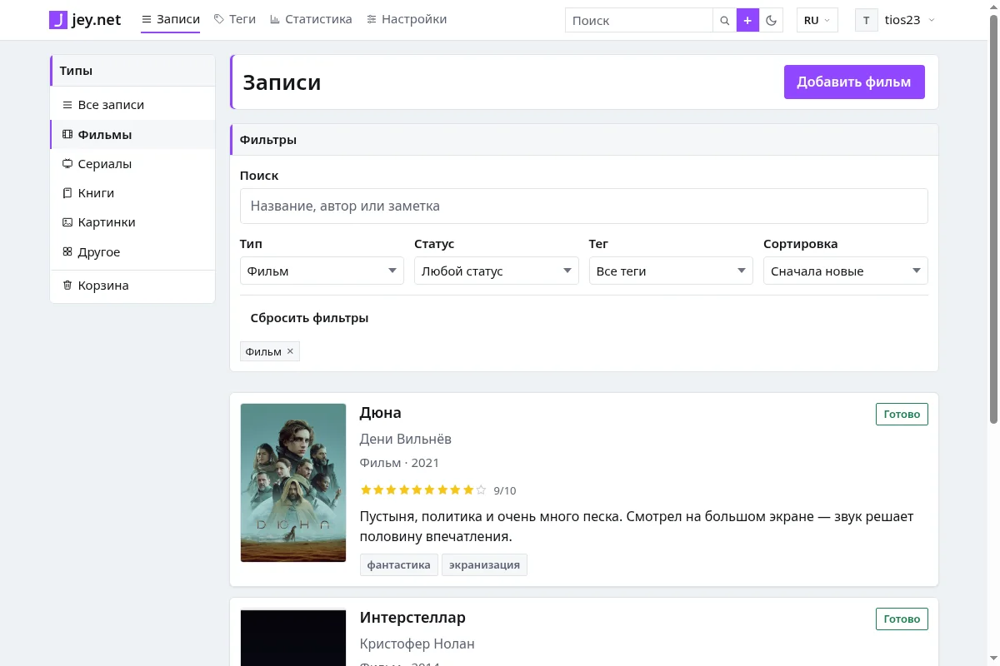

# jey.net

Личный портал для коллекционирования того, что ты смотрел, читал и сохранял:
фильмы, книги, картинки и «всякое такое» — в одном месте, со своими оценками,
заметками, тегами и статистикой.

Работает по модели **local-first**: десктопное приложение будет хранить данные
локально и работать без интернета, сервер синхронизирует устройства и
обслуживает веб-версию. Сейчас готов веб-клиент и сервер; десктоп — этап M8.

**Живой сайт:** https://j3ynet.site



## Что уже работает

- **Аккаунты:** регистрация, вход, выход, смена и сброс пароля,
  подтверждение email, удаление аккаунта, аватар, отзыв всех сессий.
- **Записи:** фильмы, книги, картинки, «другое»; статусы, оценки 1–10,
  заметки, ссылки-источники, теги, мягкое удаление и восстановление.
- **Поиск и фильтры:** триграммный поиск по названию, автору и заметке,
  фильтры по типу, статусу, году, оценке и тегу, шесть сортировок,
  курсорная пагинация.
- **Статистика:** всего записей, разбивка по типам и статусам, средняя
  оценка, по годам и за последние 12 месяцев.
- **Медиа:** загрузка JPEG/PNG/WebP до 10 МБ, обложки и аватары,
  WebP-рендиции 1200 и 400 px, квота 200 МБ на аккаунт, сборка мусора.
- **Экспорт и импорт:** JSON и CSV, идемпотентный импорт.
- **Публичный профиль:** по желанию, только завершённые записи, без заметок
  и планов.
- **Прод:** HTTPS (Let's Encrypt), systemd, мониторинг, деплой одной командой
  с миграциями и откатом.

## Стек

| Слой | Технология |
|---|---|
| Ядро | Rust (edition 2024), крейт `jey-core` — домен и правила синхронизации |
| Сервер | axum, tokio, sqlx, PostgreSQL 18 |
| Веб | Vite, React 19, React Router, TypeScript, CSS Modules |
| Десктоп | Tauri 2 + SQLite — этап M8 |
| Пароли и сессии | argon2id, непрозрачные токены, в базе только SHA-256 |
| Файлы | локальный диск VPS, без объектного хранилища |
| Деплой | VPS + Caddy + systemd, деплой-скрипт с откатом |
| CI | GitHub Actions |

Подробнее — [docs/stack.md](docs/stack.md).

## Быстрый старт

Нужны Rust, Node.js 22 и PostgreSQL 18.

```bash
cp .env.example .env                 # адрес БД и настройки
bash scripts/db.sh create            # создать базу (если ещё нет)
bash scripts/db.sh migrate           # применить миграции

cargo run -p jey-api                 # API на http://127.0.0.1:8080

cd apps/web
npm ci
npm run dev                          # SPA на http://localhost:5174
```

Демо-данные:

```bash
bash scripts/seed.sh                 # аккаунт и 200 записей
```

Проверки:

```bash
bash scripts/check.sh                # fmt, clippy, тесты, release-сборка
cd apps/web && npm run build
```

## Документация

| Документ | О чём |
|---|---|
| [docs/spec.md](docs/spec.md) | Продукт, роли, функции, критерии приёмки |
| [docs/architecture.md](docs/architecture.md) | Компоненты, модель данных, безопасность, деплой |
| [docs/api.md](docs/api.md) | Практическое руководство по API с примерами |
| [docs/openapi.yaml](docs/openapi.yaml) | OpenAPI 3.1, все эндпоинты v1 |
| [docs/protocol.md](docs/protocol.md) | Полный текстовый контракт HTTP API |
| [docs/sync.md](docs/sync.md) | Протокол синхронизации (этап M8) |
| [docs/deploy.md](docs/deploy.md) | Провижининг, Postgres, systemd, Caddy, секреты |
| [docs/monitoring.md](docs/monitoring.md) | Health-check, алерты, ротация логов |
| [docs/security.md](docs/security.md) | Аудит безопасности и остаточные риски |
| [docs/perf.md](docs/perf.md) | Нагрузочные тесты и LCP |
| [docs/runbook.md](docs/runbook.md) | Что делать, когда всё сломалось |
| [docs/workflow.md](docs/workflow.md) | Как ведётся работа над задачами |
| [ROADMAP.md](ROADMAP.md) | План работ по задачам |

## Структура репозитория

```
jey.net/
├── crates/
│   ├── core/         # домен, репозитории, правила синхронизации
│   └── api/          # HTTP-сервер (axum, sqlx, PostgreSQL)
├── frontend/         # общие компоненты, стили и i18n
├── apps/web/         # Vite SPA — единственный веб-клиент
├── deploy/           # Caddyfile, systemd-юниты, документация по деплою
├── migrations/       # серверные миграции
├── scripts/          # db.sh, seed.sh, check.sh, deploy.sh, provision.sh
└── docs/
```

## Статус

Готово: M0–M7, веб-версия 0.1.0. Дальше — M8: десктоп на Tauri 2 и
синхронизация. Текущая задача — в [ROADMAP.md](ROADMAP.md).

## Известные ограничения 0.1.0

- **Письма не доставляются:** SMTP не настроен, письма подтверждения и сброса
  пароля пишутся файлами на сервере. Для реальных пользователей это блокер.
- **Нет резервных копий:** T77 отложена сознательно; при потере диска данные
  не восстановить.
- **Один сервер:** единая точка отказа, без репликации и CDN.
- **Десктопа и синхронизации ещё нет** — это M8.
- Интерфейс только на русском (в коде есть задел под `en`/`uk`).

## Лицензия

Личный некоммерческий проект. Код не предназначен для распространения;
лицензия будет определена позже.
